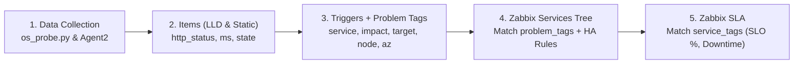

# สรุปการออกแบบ Services และ SLA สำหรับ OpenStack Monitoring บน Zabbix 6.0
*(OpenStack Zabbix 6.0 Services & SLA Architecture Summary)*

เอกสารฉบับนี้สรุปแนวทางการออกแบบ **Zabbix Services** และ **SLA** สำหรับโปรเจกต์ OpenStack API Probe ([`zbx-template-os-api-probe.yaml`](./zbx-template-os-api-probe.yaml), [`zbx-template-os-deps.yaml`](./zbx-template-os-deps.yaml), [`os_probe.py`](./os_probe.py), และ [`os_zabbix_setup.py`](./os_zabbix_setup.py)) โดยครอบคลุมทั้งเรื่องการคิด **Availability (Uptime)**, **Response Time (Latency)**, การแยกคิดรายเซอร์วิส โดย **ไม่มี SLA รวมของ OpenStack ทั้งระบบ (OpenStack Overall / All)** — แต่ละเซอร์วิสและแต่ละ Product มี SLA ของตัวเอง

---

## 1. ภาพรวมกลไกการทำงาน: Template, LLD, Tags และ Services

### 1.1 ลำดับการไหลของข้อมูลไปสู่ SLA (Data Flow to SLA)
ใน Zabbix 6.0 ตัว **SLA ไม่ได้อ่านค่าตัวเลขจาก Item (เช่น HTTP status หรือ `ms`) โดยตรง** แต่อ่านจากระยะเวลาที่ **Zabbix Service** ตกอยู่ในสถานะมีปัญหา (Problem state) โดยมีลำดับดังนี้:



### 1.2 คำถามสำคัญ: สร้าง Service/SLA ไปพร้อมกับ Template และทำ LLD Discover เหมือน Item ได้ไหม?
* **ไม่สามารถใส่ในไฟล์ `.yaml` Template หรือใช้ LLD สร้าง Service/SLA ได้โดยตรง**:
  * ในสถาปัตยกรรมของ Zabbix (6.0–7.0) `Services` และ `SLA` เป็น **Global Objects** ระดับ Zabbix Server (เพราะ 1 Service ต้องรวบรวมสถานะข้ามหลาย Host เช่น โหนด AZ Probe, โหนด Controller 1–3, โหนด DB/RabbitMQ) จึงไม่มีโครงสร้าง `services:` หรือ `slas:` ใน YAML Template Export และไม่มี Service Prototype ใน LLD
* **แต่ไม่ต้องนั่งคลิกสร้างมือหรือติด Tag เองทีละตัว เพราะระบบใช้กลไกอัตโนมัติ 2 ส่วน**:
  1. **ฝั่ง Item & Trigger ติด Tag อัตโนมัติด้วย LLD (ไม่ต้องทำมือ)**:
     * ใน [`zbx-template-os-api-probe.yaml`](./zbx-template-os-api-probe.yaml) ตั้งค่า LLD Trigger Prototypes ให้ดึงค่าจาก JSON มาแปะ Problem Tags ให้อัตโนมัติทุกตัว เช่น `service={#SERVICE}`, `layer={#LAYER}`, `component={#CHECK}`, `target={#TARGET}`, `node={#NODE}`, `impact=availability|stability`
     * **สิ่งที่ต้องติดเองที่ Host มีเพียงจุดเดียว**: คือการใส่ Host Tag `az=<ชื่อ AZ>` (เช่น `az=BKK`) ที่ตัว Host ใน Zabbix
  2. **ฝั่ง Zabbix Services & SLA สร้างอัตโนมัติผ่าน API ด้วย [`os_zabbix_setup.py`](./os_zabbix_setup.py)**:
     * แทนที่จะคลิกสร้าง Service นับร้อยกิ่งในหน้าเว็บ Zabbix เราใช้สคริปต์ [`os_zabbix_setup.py`](./os_zabbix_setup.py) ยิง Zabbix JSON-RPC API (`service.create`, `sla.create`) เพื่อสร้างต้นไม้ Services, ผูก `problem_tags`, และสร้าง `SLA` ทั้งหมดในคำสั่งเดียว (รันซ้ำแบบ Idempotent ได้ตลอด)

---

## 2. ความพร้อมของ Tag ในปัจจุบัน (โดยไม่ต้องสร้าง Trigger ใหม่)

จากการตรวจสอบ [`zbx-template-os-api-probe.yaml`](./zbx-template-os-api-probe.yaml) และ [`zbx-template-os-deps.yaml`](./zbx-template-os-deps.yaml) พบว่า **Tag ที่มีอยู่ในปัจจุบันเพียงพอสำหรับการทำ Service และแยกคิดทั้ง Availability และ Response Time ได้ทันที** โดยไม่ต้องเพิ่ม Trigger ใหม่ใน Template:

### 2.1 ตารางการจับคู่ Tag ปัจจุบันเข้ากับ Zabbix Service

| สิ่งที่ต้องการวัดใน Service | Trigger ที่มีอยู่แล้วใน Template | Problem Tags ที่ใช้ดักจับใน Zabbix Service (`problem_tags`) | หมายเหตุ |
| :--- | :--- | :--- | :--- |
| **1. API ล่มผ่าน VIP (L2/L3)** | `OpenStack {#LABEL}: {#CHECK} @ {#TARGET} is down` | `service=<svc>`, `target=vip`, `impact=availability`, `az=<AZ>` | ถ้าระดับ L2 `@ vip` ล่ม LLD Override จะปรับเป็น `DISASTER` อัตโนมัติ |
| **2. API ล่มรายโหนด Controller** | `OpenStack {#LABEL}: {#CHECK} @ {#TARGET} is down` | `service=<svc>`, `target=<ctl_ip>`, `impact=availability`, `az=<AZ>` | อยู่ภายใต้กิ่ง `controllers` ที่ใช้กฎ HA (`ALG_ALL`: ต้องล่มทุกโหนดจึงนับว่าบริการล่ม) |
| **3. Service Agent ล่มรายโหนด** (`nova-scheduler`, `cinder-volume`, `heat-engine` ฯลฯ) | `OpenStack {#LABEL}: {#BINARY} on {#HOST} is down` | `service=<svc>`, `node~<ctl_hostname>`, `impact=availability`, `az=<AZ>` | ยกเว้น `nova-compute` ที่สคริปต์ส่ง `impact=stability` เพื่อไม่ให้ Compute โหนดเดียวล่มแล้วฉุด SLA ทั้งระบบ |
| **4. ฟังก์ชันหลักหรือ Cluster ล่ม (L3)** | • `Keystone: cannot issue tokens`<br>• `Keystone: catalog lost a service`<br>• `Nova: no schedulable hypervisor left`<br>• `Cinder: pool {#POOL} backend is down`<br>• `Glance: a store disappeared` / `canary failing`<br>• `OpenSDN: no functional {#MODULE} left` | `service=<svc>`, `layer=L3`, `impact=availability`, `az=<AZ>` *(และไม่มี `node`)* | **ข้อควรระวังสำคัญ**: Trigger กลุ่มนี้ไม่มี Tag `target=vip` (ดูหัวข้อ 2.2 ด้านล่าง) |
| **5. ความเร็ว Response Time ช้าผ่าน VIP** | `OpenStack {#LABEL}: {#CHECK} @ {#TARGET} is slow` (`>{$OS_LATENCY.WARN:"{#SERVICE}"}`) | `service=<svc>`, `target=vip`, `impact=stability`, `az=<AZ>` | Trigger อื่นที่เป็น `impact=stability` (เช่น agent disabled, cert ใกล้หมดอายุ, hypervisor down) ไม่มี `target=vip` จึงใช้ชุด Tag นี้แยกดึงเฉพาะ **ความช้าที่ VIP** ได้ทันที |
| **6. ความเร็วการออก Token ของ Keystone ช้า** | `OpenStack Keystone: token issue is slow` (`>{$OS_AUTH.WARN}`) | `service=keystone`, `component=token`, `impact=stability`, `az=<AZ>` | ดึงเฉพาะความช้าในการขอ Token ของ Keystone |

### 2.2 จุดที่ต้องปรับใน [`os_zabbix_setup.py`](./os_zabbix_setup.py) เพื่อให้ครอบคลุม 100%
ในโค้ดปัจจุบันของ [`os_zabbix_setup.py`](./os_zabbix_setup.py) (ฟังก์ชัน `Builder.component` บรรทัดที่ 172–184) กิ่งของเซอร์วิสประเภท `api` ดักเฉพาะ:
1. กิ่ง `VIP`: `service=<comp>` + `target=vip` + `impact=availability`
2. กิ่ง `controllers`: `target=<ctl_ip>` และ `node~<ctl_hostname>`

**ผลกระทบ**: Trigger ระดับ Cluster ที่อยู่ในข้อ 4 ของตารางด้านบน (เช่น ขอ Token ไม่ได้, Hypervisor ไม่เหลือที่พร้อมรับงาน, Cinder Pool ล่ม, Glance Store หาย/Canary ล่ม) มี Tag `service=<comp>` + `layer=L3` + `impact=availability` แต่ **ไม่มี Tag `target=vip`** ทำให้ไม่เข้ากิ่ง `VIP`!
* **วิธีแก้ไข (ไม่ต้องแก้ Template)**: เพิ่มกิ่งย่อย `<Service> · Cluster / L3` ใน [`os_zabbix_setup.py`](./os_zabbix_setup.py) ที่ดัก `service=<comp>` + `component=<token|catalog|hypervisors|stores|canary|...>` (หรือใส่ `target: vip` ให้ Trigger เหล่านี้ใน Template)

---

## 3. กฎเกณฑ์มาตรฐานของการคิด Service & SLA (Finalized SLA Rules)

ตามข้อตกลงการออกแบบ ระบบกำหนดค่าเป้าหมาย **SLO ของทุก SLA ไว้ที่ `99.9%`** โดยมีเกณฑ์การนับ Downtime เข้าสู่ SLA ดังนี้:

1. **OpenStack Service (แต่ละเซอร์วิสมี 2 Services & 2 SLAs — SLO `99.9%`)**:
   * **กิ่งที่ 1: Availability (`<AZ> · <Service> · Availability`)**:
     * ดูการทำงานของเซอร์วิสผ่าน VIP (`target=vip`), ฟังก์ชันระดับ L3 Cluster (`layer=L3`), และสถานะรายโหนด Controller
     * กรณีมีหลายโหนด (`controllers`) ใช้กฎ **`ALG_ALL` ("Most critical if ALL children have problems")** คือตราบใดที่จำนวนโหนดที่ทำงานอยู่ยังมีมากกว่า 0 (`running nodes > 0`) กิ่ง `controllers` จะยังเป็น `OK`
     * **เกณฑ์ SLA**: ต้องเกิดปัญหาต่อเนื่อง **เกิน 5 นาทีขึ้นไป** (`#3` รอบ × 2 นาที = ~5–6 นาที) จึงจะทริกเกอร์และนำมาคิด SLA
   * **กิ่งที่ 2: Response Time (`<AZ> · <Service> · Response Time`)**:
     * ดูเวลาตอบสนองของ API ผ่าน VIP (`os.api.ms` และ `os.fast.auth.ms` ของ Keystone)
     * **เกณฑ์ SLA**: ตอบสนองช้า **เกินกว่า 5 วินาที (`> 5000 ms`) ติดต่อกัน 3 ครั้ง (`#3` รอบ)** จึงจะทริกเกอร์และนำมาคิด SLA (`{$OS_LATENCY.WARN} = 5000`, `{$OS_AUTH.WARN} = 5000`)

2. **RabbitMQ (`<AZ> · RabbitMQ` — 1 Service & 1 SLA, SLO `99.9%`)**:
   * **Availability**: ตรวจสอบ 4 เงื่อนไขหลักระดับ Cluster (`service=rabbitmq`, `component=rabbitmq`, `impact=availability`):
     1. Connect Management API ไม่ได้เกิน 5 นาที (`nodata(/.../os.deps.rabbitmq,5m)=1`)
     2. โหนดที่รันอยู่เหลือน้อยกว่าหรือเท่ากับครึ่งหนึ่ง (`nodes.running * 2 <= nodes.total` ต่อเนื่อง `#5` รอบ = 5 นาที)
     3. เกิด Network Partition (`partitions > 0` ต่อเนื่อง `#5` รอบ = 5 นาที)
     4. เกิด Memory หรือ Disk Alarm ที่บล็อก Publisher (`mem_alarm=1` หรือ `disk_alarm=1` ต่อเนื่อง `#5` รอบ = 5 นาที)
   * **เกณฑ์ SLA**: เกิดปัญหาเกิน **5 นาที** นำมาคิด SLA

3. **HAProxy (`<AZ> · HAProxy` — 1 Service & 1 SLA, SLO `99.9%`)**:
   * **Availability**: ดูสถานะ Backend (`haproxy.backend.state["{#PXNAME}"]=0`, `service=haproxy`, `impact=availability`)
   * **เกณฑ์ SLA**: Backend Down เกิน **5 นาที (`#5` รอบ)** นำมาคิด SLA

> [!NOTE]
> **ไม่มี SLA รวม OpenStack ทั้งระบบ (OpenStack Overall)**: ไม่สร้างกิ่ง `<AZ> · OpenStack Overall`, ไม่ใช้ `Weight` / `status_rules type=2` และไม่มี SLA `overall-avail` / `overall-resp` อีกต่อไป เซอร์วิสหนึ่งล่มหรือช้าจะกระทบเฉพาะ SLA ของเซอร์วิสนั้น (และ Product ที่มันเป็นส่วนหนึ่ง) เท่านั้น

**โครงสร้าง Zabbix Service Tree ต่อ 1 AZ (สร้างอัตโนมัติโดย [`os_zabbix_setup.py`](./os_zabbix_setup.py)):**

```text
AZ-BKK
  ├── BKK · Compute (Product)                        [sla=compute]  <-- ผูก SLA ของ Product (ถ้ากำหนดใน config)
  │     └── (Availability ของแต่ละ component ที่เป็นสมาชิก)
  └── BKK · Nova                                     [service=nova]
        ├── BKK · Nova · Availability                [sla=nova-avail] <-- ผูก SLA Availability (99.9%, ล่ม >= 5m)
        │     ├── BKK · Nova · VIP                   (problem_tags: service=nova, target=vip, impact=availability)
        │     ├── BKK · Nova · L3 Cluster            (problem_tags: service=nova, layer=L3, impact=availability)
        │     └── BKK · Nova · controllers           (ALG_ALL: ปกติตราบใดที่โหนดทำงาน > 0; ล่มเมื่อพังทุกโหนด >= 5m)
        │           ├── BKK · Nova · bkk-ctl1        (API target=10.0.0.11 + services node~bkk-ctl1)
        │           ├── BKK · Nova · bkk-ctl2
        │           └── BKK · Nova · bkk-ctl3
        └── BKK · Nova · Response Time               [sla=nova-resp]  <-- ผูก SLA Response Time (99.9%, > 5s x 3 รอบ)
              └── (problem_tags: service=nova, target=vip, impact=stability)
```

---

## 4. รายละเอียด Services และ SLA ของแต่ละ OpenStack Service

ตารางด้านล่างสรุปองค์ประกอบของแต่ละเซอร์วิส (ดูตารางเต็มได้ใน [`openstack_services_sla_matrix.csv`](./openstack_services_sla_matrix.csv)):

### 4.1 กลุ่ม Shared Critical & Portal
| OpenStack Service | กิ่ง Availability (`impact=availability`, ล่ม >= 5 นาที) | กิ่ง Response Time (`impact=stability`, > 5s ติดกัน 3 รอบ) | SLO Target |
| :--- | :--- | :--- | :---: |
| **Keystone** (`keystone`) | • **VIP**: L2 root (`target=vip`, `#3` รอบ)<br>• **L3 Cluster**: ออก Token ไม่ได้ (`#3` รอบ), บริการใน Catalog หาย (`layer=L3`)<br>• **Controllers (`ALG_ALL`)**: L2 API รายโหนด (`target=<ctl_ip>`) | • **Token Latency**: `component=token` (`os.fast.auth.ms > 5000 ms` x 3 รอบ)<br>• **VIP Latency**: `target=vip` (`os.api.ms > 5000 ms` x 3 รอบ) | `99.9%` |
| **Horizon** (`horizon`) | • **VIP Login**: หน้า `/auth/login/` ล่มติดต่อกัน `#3` รอบ (`target=vip`) | • **VIP Login Latency**: โหลดหน้า `/auth/login/ > 5000 ms` ติดกัน 3 รอบ (`target=vip`) | `99.9%` |

### 4.2 กลุ่ม Core Services
| OpenStack Service | กิ่ง Availability (`impact=availability`, ล่ม >= 5 นาที) | กิ่ง Response Time (`impact=stability`, > 5s ติดกัน 3 รอบ) | SLO Target |
| :--- | :--- | :--- | :---: |
| **Nova** (`nova`) | • **VIP**: L2 root + noVNC (`target=vip`, `#3` รอบ)<br>• **L3 Cluster**: ไม่เหลือ Hypervisor ที่ schedule ได้ (`layer=L3`)<br>• **Controllers (`ALG_ALL`)**: L2 API + `nova-scheduler`, `nova-conductor` (`#3` รอบ) | • **VIP Latency**: เวลาตอบสนองของ Nova API และ noVNC `> 5000 ms` ติดกัน 3 รอบ | `99.9%` |
| **Placement** (`placement`) | • **VIP**: L2 root (`target=vip`, `#3` รอบ)<br>• **Controllers (`ALG_ALL`)**: L2 API รายโหนด (`#3` รอบ) | • **VIP Latency**: เวลาตอบสนอง Placement API `> 5000 ms` ติดกัน 3 รอบ | `99.9%` |
| **Glance** (`glance`) | • **VIP**: L2 root + L3 `/images?limit=1` (`target=vip`, `#3` รอบ)<br>• **L3 Cluster**: Store หาย / ดาวน์โหลด Canary ล้มเหลว (`layer=L3`)<br>• **Controllers (`ALG_ALL`)**: L2 API รายโหนด (`#3` รอบ) | • **VIP Latency**: เวลาตอบสนอง Glance API `> 5000 ms` ติดกัน 3 รอบ | `99.9%` |
| **Cinder** (`cinder`) | • **VIP**: L2 root + L3 `/os-services` (`target=vip`, `#3` รอบ)<br>• **L3 Cluster**: Cinder Pool backend down (`layer=L3`)<br>• **Controllers (`ALG_ALL`)**: L2 API + `cinder-scheduler`, `cinder-volume`, `cinder-backup` (`#3` รอบ) | • **VIP Latency**: เวลาตอบสนอง Cinder API `> 5000 ms` ติดกัน 3 รอบ | `99.9%` |
| **Neutron** (`neutron`) | • **VIP**: L2 root + L3 `/v2.0/networks?limit=1` (`target=vip`, `#3` รอบ)<br>• **Controllers (`ALG_ALL`)**: L2 API รายโหนด (`#3` รอบ) | • **VIP Latency**: เวลาตอบสนอง Neutron API `> 5000 ms` ติดกัน 3 รอบ | `99.9%` |
| **OpenSDN** (`opensdn`) | • **SDN Modules & Nodes**: โมดูลตายครบทุกโหนด (`os.sdn.module.up=0`) หรือ API รายโหนดพังครบทุกโหนด >= 5 นาที | • **SDN Latency**: ความช้า `> 5000 ms` ติดกัน 3 รอบ | `99.9%` |

### 4.3 กลุ่ม Non-Core / Add-on Services
| OpenStack Service | กิ่ง Availability (`impact=availability`, ล่ม >= 5 นาที) | กิ่ง Response Time (`impact=stability`, > 5s ติดกัน 3 รอบ) | SLO Target |
| :--- | :--- | :--- | :---: |
| **Octavia** (`octavia`) | • **VIP**: L2 root + L3 `/v2/lbaas/providers` (`#3` รอบ)<br>• **Controllers (`ALG_ALL`)**: L2 API รายโหนด + พอร์ต UDP 5555 (`#5` รอบ = 5 นาที) | • **VIP Latency**: เวลาตอบสนอง Octavia API `> 5000 ms` ติดกัน 3 รอบ | `99.9%` |
| **Heat** (`heat`) | • **VIP**: L2 root + L3 `/services` (`#3` รอบ)<br>• **Controllers (`ALG_ALL`)**: L2 API รายโหนด + `heat-engine` (`#3` รอบ) | • **VIP Latency**: เวลาตอบสนอง Heat API `> 5000 ms` ติดกัน 3 รอบ | `99.9%` |
| **Magnum** (`magnum`) | • **VIP**: L2 root + L3 `/mservices` (`#3` รอบ)<br>• **Controllers (`ALG_ALL`)**: L2 API รายโหนด + `magnum-conductor` (`#3` รอบ) | • **VIP Latency**: เวลาตอบสนอง Magnum API `> 5000 ms` ติดกัน 3 รอบ | `99.9%` |
| **Barbican** (`barbican`) & **Trove** (`trove`) | • **VIP**: L2 root (+ Trove `/datastores`) (`#3` รอบ)<br>• **Controllers (`ALG_ALL`)**: L2 API รายโหนด (`#3` รอบ) | • **VIP Latency**: เวลาตอบสนองที่ `target=vip` `> 5000 ms` ติดกัน 3 รอบ | `99.9%` |
| **Ironic / Manila / Swift** | • **VIP**: L2 root (`#3` รอบ)<br>• **Controllers (`ALG_ALL`)**: L2 API รายโหนด + services (`#3` รอบ) | • **VIP Latency**: เวลาตอบสนองที่ `target=vip` `> 5000 ms` ติดกัน 3 รอบ | `99.9%` |

### 4.4 กลุ่ม L4 Core Infrastructure Dependencies ([`zbx-template-os-deps.yaml`](./zbx-template-os-deps.yaml))
| L4 Component | กฎการคิดสถานะ (HA / Quorum Rule — เกิน 5 นาที `#5` รอบจึงคิด SLA) | Problem Tags (`impact=availability` + `az=<AZ>`) | SLO Target |
| :--- | :--- | :--- | :---: |
| **RabbitMQ** (`rabbitmq`) | **1 Service (`ALG_ANY`)**: Connect API ไม่ได้เกิน 5 นาที (`nodata 5m`), โหนดรัน `<= 50%` เกิน 5 นาที (`#5`), Network Partition `> 0` เกิน 5 นาที (`#5`), หรือติด Memory/Disk Alarm (บล็อก Publisher) เกิน 5 นาที (`#5`) | `service=rabbitmq`, `component=rabbitmq` | `99.9%` |
| **HAProxy** (`haproxy`) | **1 Service (`ALG_ANY`)**: Backend state Down (`=0`) ติดต่อกันเกิน 5 นาที (`#5` รอบ) | `service=haproxy` | `99.9%` |
| **MariaDB Galera** (`mariadb`) | **Quorum Rule**: มีโหนดลูกอย่างน้อย 2 ใน 3 โหนดที่มีปัญหา (`mysql.ping=0` หรือ `galera` หลุด `#5` รอบ = 5 นาที) → `Disaster` | `service=mariadb`, `node=<ctl_host>` | `99.9%` |
| **keepalived** (`keepalived`) | **Cluster Rule (`ALG_ANY`)**: ไม่มีโหนดใดถือ VIP เลย (`sum=0`) หรือถือซ้ำกัน (`sum>1` split-brain) เกิน 5 นาที (`#5` รอบ) | `service=keepalived` | `99.9%` |
| **memcached** (`memcached`) | **All-Nodes Rule (`ALG_ALL`)**: นับเป็นล่มเมื่อ memcached ล่มครบทุก Controller เกิน 5 นาที (`#5` รอบ) | `service=memcached`, `node=<ctl_host>` | `99.9%` |

---

## 5. การไม่คิด SLA รวมของ OpenStack ทั้งระบบ (No "OpenStack Overall" SLA)

ตามข้อกำหนดล่าสุด **ไม่คิด SLA รวมของ OpenStack ทั้งระบบ** (ไม่มีตัวเลข "OpenStack All / Overall" ต่อ AZ) เพราะการรวมเซอร์วิสทั้งหมดเป็นตัวเลขเดียวทำให้ตีความยาก — SLA จึงวัดเป็น 2 ระดับเท่านั้น:

1. **Per-Service SLA**: วัดแยกแต่ละเซอร์วิส (`Keystone`, `Nova`, `Cinder`, `Neutron`, `Octavia`, `Heat`, `HAProxy`, `RabbitMQ` ฯลฯ) — เซอร์วิสแบบ API มีทั้งกิ่ง **Availability** และ **Response Time**, ส่วน L4 (`MariaDB`, `RabbitMQ`, `HAProxy`, `keepalived`, `memcached`) มีเฉพาะ **Availability**
2. **Product SLA** *(ไม่บังคับ — ใช้เมื่อกำหนด `products` ใน config)*: รวมเฉพาะกิ่ง Availability ของเซอร์วิสที่ลูกค้าใช้งานจริงเป็นชุดเดียว (`Compute`, `Block Storage`, `Network`, `Load Balancer`, `Identity` ตาม [`deploy/os_zabbix_setup.example.json`](./deploy/os_zabbix_setup.example.json)) ถ้าไม่ต้องการ ให้ลบ key `products` ออก

**สิ่งที่ถูกถอดออก**: กิ่ง `<AZ> · OpenStack Overall` (+ `· Availability`, `· Response Time`), SLA `SLA - <AZ> - OpenStack Overall - *`, Tag `sla=overall-avail|overall-resp`, ระบบถ่วงน้ำหนัก (`weights`, `overall.weight_threshold`, `Weight`/`status_rules type=2`) และคอลัมน์ `Overall_Weight` / `Count_In_Overall_OpenStack_SLA` ใน [`openstack_services_sla_matrix.csv`](./openstack_services_sla_matrix.csv)

> [!TIP]
> เมื่อรัน [`os_zabbix_setup.py`](./os_zabbix_setup.py) บน Zabbix ที่เคยสร้าง Overall ไว้แล้ว สคริปต์จะ **ลบ Service/SLA `OpenStack Overall` เดิมให้อัตโนมัติ** (`remove_legacy_overall`) เซอร์วิสที่ไม่ได้อยู่ใต้ Product ใด จะถูกผูกไว้ใต้ `AZ-<AZ>` โดยตรง

---

## 6. สรุปสิ่งที่ต้องทำในขั้นถัดไป (Action Plan)

1. **ไม่ต้องแก้โครงสร้าง Item ใน Template และไม่ต้องนั่งสร้าง Service มือในเว็บ Zabbix**
2. รัน `python3 os_zabbix_setup.py -c deploy/os_zabbix_setup.example.json --dry-run` เพื่อตรวจ แล้วรันจริง (`--only services,sla`) เพื่อสร้างต้นไม้ใหม่และลบ Overall เดิม
3. สคริปต์สร้างกิ่ง **`Availability`** (`impact=availability`) และ **`Response Time`** (`impact=stability` + `target=vip`) ของแต่ละเซอร์วิส พร้อม SLA รายเซอร์วิสและราย Product และนำขึ้น Dashboard อัตโนมัติ
